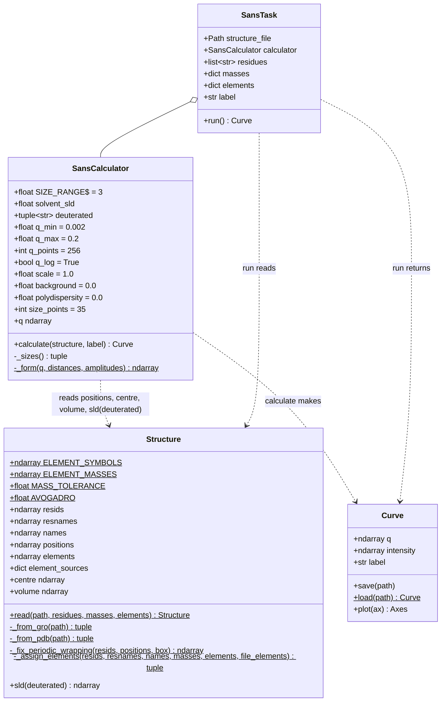
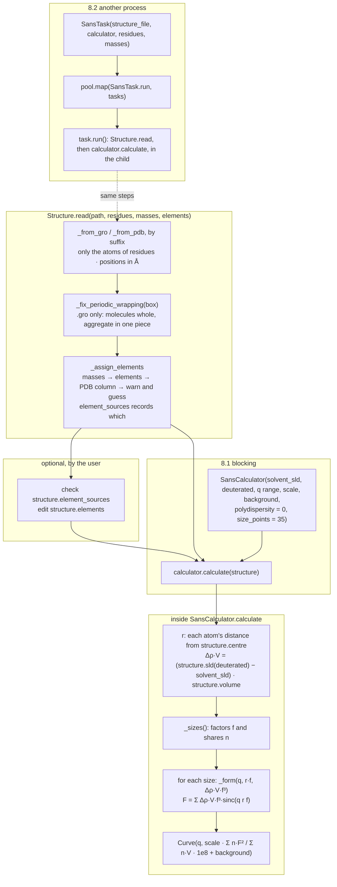
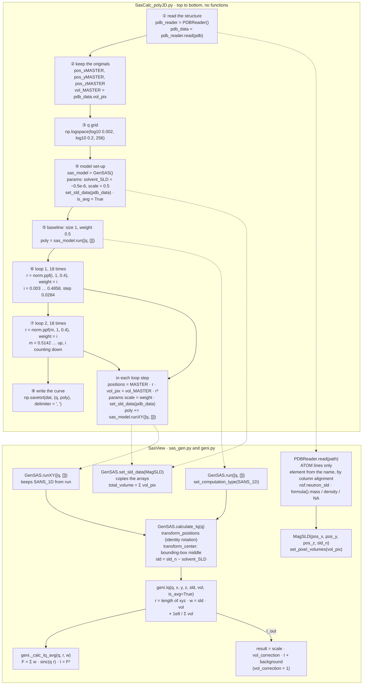
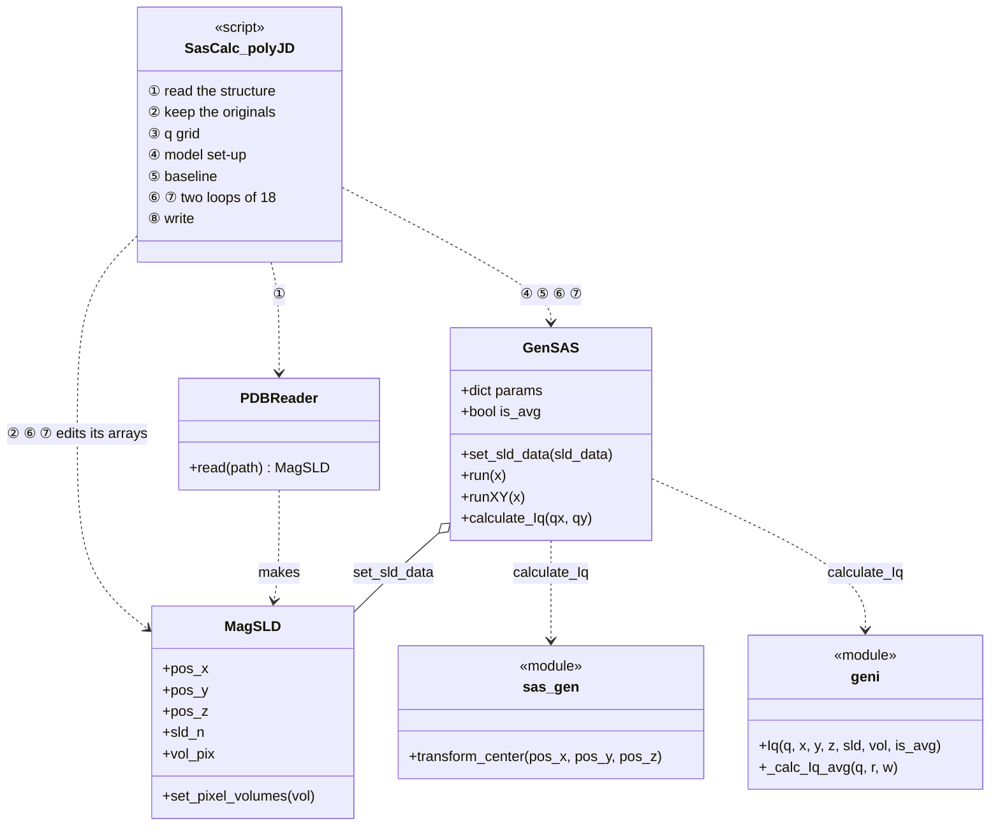

# coords2sans

A toolkit to calculate small-angle neutron scattering (SANS) curves I(q) from atom
coordinates: for example a micelle or a vesicle from a molecular dynamics (MD)
simulation.

> **Status: first version.** The four classes are written and tested. Two notebooks in
> `examples/` show how to use them and compare them with SasView and sasmodels.

- **Light:** depends only on numpy and periodictable. matplotlib is optional, for
  plotting. No SasView, no MD framework.
- **The physics of SasView's `GenSAS`** with `is_avg = True`, the spherical average.
  Optionally it adds a Gaussian spread of sizes, combined as sasmodels does.
- **Reads** GROMACS `.gro` and `.pdb` files, and puts aggregates that the periodic box
  split back together.
- **Object-oriented and small:** four classes. A whole calculation can be sent to
  another process as one picklable object.
- **Checked against SasView and sasmodels:** one size equals SasView's `GenSAS`, and a
  spread of sizes equals the `sphere` model of sasmodels (`examples/compare.ipynb`).

It grew out of a SasView-based script used by our users, `SasCalc_polyJD.py`; the last
section compares the two.

## Contents

1. [Development setup](#1-development-setup)
2. [What one structure stands for](#2-what-one-structure-stands-for)
3. [Layout](#3-layout)
4. [Structure](#4-structure)
5. [SansCalculator](#5-sanscalculator)
6. [Polydispersity](#6-polydispersity)
7. [Curve and SansTask](#7-curve-and-sanstask)
8. [Usage](#8-usage)
9. [Workflow](#9-workflow)
10. [Compared with SasCalc_polyJD.py and SasView](#10-compared-with-sascalc_polyjdpy-and-sasview)

The diagrams are Mermaid; GitHub renders them.

## 1. Development setup

The environment is managed with [pixi](https://pixi.sh). It installs Python, JupyterLab
and the package in editable mode, with the `dev` and `plot` extras.

```bash
pixi install            # create the environment (default: Python 3.13)
pixi run test           # unit tests
pixi run notebook-tests # run the notebooks in examples/; compare.ipynb downloads two
                        # SasView files on its first run
pixi run jupyter lab    # open the notebooks
pixi run check          # pyproject, docstring, lint and format checks
pixi run fix            # auto-format and fix lint
pixi run unit-tests-coverage
pixi run dist-build     # build a wheel into dist/
pixi run -e py-min test # the same tests on Python 3.11, the oldest supported
```

The version comes from git tags (`v*`), via versioningit.

## 2. What one structure stands for

A measurement sees thousands of micelles; the calculation uses one. They match under
these conditions, and each is something the calculation takes for granted:

| The sample has | The calculation covers it with |
|---|---|
| thousands of micelles, far apart and placed at random (dilute) | each micelle scatters on its own, so the sample is n × one micelle; `scale` is the volume fraction. No interference between micelles: the structure factor S(q) = 1 |
| micelles pointing in random directions | the spherical average (`GenSAS` `is_avg`): the amplitude F = Σ Δρ·V·sinc(q r), with r measured from the micelle's centre. Exact for a spherically symmetric object, an approximation for rods and flat bilayers |
| micelles of different sizes | the size distribution (section 6) |
| micelles of different shapes at any instant | one MD frame; averaging over frames comes later |
| solvent, and incoherent scattering | a constant solvent SLD; each atom displaces solvent of its own volume (Δρ = its SLD − the solvent's); a flat `background` |
| an instrument with finite resolution | not covered |

## 3. Layout

```
coords2sans/
  pyproject.toml            # dependencies: numpy, periodictable; extras: plot, dev
  pixi.toml                 # development environment and tasks
  src/coords2sans/
    __init__.py             # re-exports the four classes
    structure.py            # Structure
    calculator.py           # SansCalculator, SansTask
    curve.py                # Curve
  tests/unit/               # one test file per module
  examples/
    usage.ipynb             # one curve blocking, many curves in worker processes
    compare.ipynb           # against SasView GenSAS, sasmodels and the polyJD script
    data/                   # a CTAB micelle (CTA only) after equilibration stages 0 and 5
```

| Class | Holds (attributes) | Does (methods) |
|---|---|---|
| `Structure` | the aggregate's atoms: residue numbers and names, atom names, positions in Å, elements, and where each residue's elements came from. The element table (H to U, and D), the mass tolerance and SasView's Avogadro number are class attributes | `read` prepares everything; then it gives the bounding-box `centre`, each atom's `volume`, and `sld(deuterated)` |
| `SansCalculator` | the settings, as plain values: solvent SLD, deuterated residues, q range, scale, background, `polydispersity`, `size_points` | gives the q values (`q`) and the curve (`calculate`). Private steps: the sizes and their shares (`_sizes`), one size's amplitude (`_form`) |
| `Curve` | q, I and a label | writes and reads a SasView-readable `.dat`; plots |
| `SansTask` | a structure file, how to read it, and a `SansCalculator` | `run()`: from the file to a `Curve`; plain picklable data, so it runs in another process |



## 4. Structure

Read once, prepared once:

```python
structure = Structure.read(path, residues=None, masses=None, elements=None)
```

`read` is the only public step. Inside it, these steps run in this order:

| Step | Method | What it does | Why |
|---|---|---|---|
| parse | `_from_gro` / `_from_pdb` | reads the fixed columns of every atom; positions in Å | the file's suffix picks the reader |
| keep the aggregate | `read` itself | keeps the atoms whose residue is in `residues` (all if None) | water and ions are the solvent, a constant SLD: their atoms are never used, so they are not kept |
| fix wrapping | `_fix_periodic_wrapping` | `.gro` only: makes each molecule whole, finds the aggregate's centre with a mean that works across the box faces, and moves whole molecules next to it | 4.1 |
| elements | `_assign_elements` | gives each atom its chemical element (C, H, N, O, P, D, Br …) | the neutron SLD and the atom volume are properties of the element; 4.2 |

After `read` the structure is only read from. The exception is `elements`, which you may
edit.

### 4.1 Periodic wrapping

An MD box repeats in every direction. When an atom leaves through one face, it comes back
in through the opposite one, and a `.gro` file stores every position put back inside the
box. This is **wrapping**. A micelle whose centre sits closer to a face than its own
radius is partly beyond that face. In the simulation it is whole. In the file, the part
beyond the face is written at the opposite face:

```
What the simulation has (the box repeats; the micelle is whole,
its centre close to the right face, so part B lies past the face):

          box                       next copy of the box
 x=0 +---------------------+ x=L +---------------------+
     |                     |     |                     |
     |               ,-----|-.   |                     |
     |              (  A   | B ) |                     |
     |               '-----|-'   |                     |
     |                     |     |                     |
     +---------------------+     +---------------------+

What the .gro stores: each atom put back into 0 <= x < L.
The atoms of part B (x >= L) are written at x - L, at the left face:

 x=0 +---------------------+ x=L
     |-.                   |
     | B )           ,-----|
     |-'            (  A   |
     |               '-----|
     |                     |
     +---------------------+
```

Wrapping is harmless to the simulation, because it is periodic: x and x + L are the same
place. The SANS calculation is not periodic. It treats the coordinates as one finite
object in an endless solvent, so from a wrapped file it computes two half-micelles a box
length apart:

- **I(0) stays right**, because at q = 0 only Σ Δρ·V counts.
- **The shape of the curve is wrong**: it shows the size of the box instead of the
  micelle, plus fringes from the gap. In a test on a CTAB micelle split on purpose, the
  radius of gyration came out 6.1 nm instead of 2.7 nm.

The SLD is per atom and has nothing to do with periodicity; only the positions are
fixed. Leaving out the periodic copies is right physically too: they would form a
lattice of micelles one box apart, which a dilute sample doesn't have.

### 4.2 Elements

A `.gro` file has no elements, only force-field atom names like `C21` or `OH2`. So the
element is worked out per residue name, from the first source that applies:

1. **Masses given per residue**, in topology order: `{"CTA": [14.007, 12.011, 1.008, …]}`.
   Each is matched by its position in the residue to the nearest element. A mass more
   than `MASS_TOLERANCE` (0.01 u) from every element is refused, which catches hydrogen
   mass repartitioning and united-atom groups. coords2sans reads no topology files; the
   caller brings the masses from its own `.itp`, `.psf` or other reader.
2. **Elements given per residue:** `{"CTA": ["N", "C", "H", …]}`, by position.
3. **The PDB element column** (columns 77–78): `.pdb` only, where it is filled.
4. **None of them:** a warning names the residues, and the elements are guessed from the
   atom names. A name that is a two-letter element (`CL`, `NA`, `BR`) gives that
   element; any other gives its first letter (`C21` → C, `HG1` → H). An atom named
   exactly `CA` becomes calcium, which is why the warning matters.

The element table covers H to U (Z = 1 to 92) and D. Any two of its elements are at least
0.0196 u apart, so a mass matches one element at most.

What came from where, and how to correct it:

- `structure.element_sources` maps each residue name to `"masses"`, `"elements"`,
  `"pdb"` or `"names"` (guessed).
- `structure.elements` is editable, whatever its source. Its setter checks the length,
  and that each symbol is known to periodictable.
- `sld()` and `volume` are computed from `elements` on every read, so an edit takes
  effect in the next `calculate`.

### 4.3 Deuteration

MD treats H and D alike, so a structure file doesn't say which hydrogens are D. That is a
choice per curve (contrast variation). D has the same atom volume as H in periodictable
(23.64 ų), so deuteration changes only the SLD, and one structure serves every contrast:
`structure.sld(deuterated=("CTA",))`. Deuteration is a calculator setting, next to the
solvent SLD. Whole residues are deuterated; per atom group comes later.

## 5. SansCalculator

The settings are plain values of its `__init__`:

| Setting | Default | Meaning |
|---|---|---|
| `solvent_sld` | (required) | the solvent's SLD in Å⁻²: −0.56e-6 for H2O, 6.36e-6 for D2O |
| `deuterated` | `()` | residues whose hydrogens are deuterium |
| `q_min`, `q_max`, `q_points`, `q_log` | 0.002, 0.2, 256, True | the q values in Å⁻¹, log or linear spacing |
| `scale` | 1.0 | the volume fraction of the aggregates |
| `background` | 0.0 | a flat background in cm⁻¹ |
| `polydispersity` | 0.0 | the spread of sizes; 0 is one size (section 6) |
| `size_points` | 35 | how many sizes stand in for the spread (section 6) |

- `q` gives the q values from `q_min`, `q_max`, `q_points` and `q_log`.
- `calculate(structure, label)` returns a `Curve`. It works out once each atom's
  distance r from the bounding-box centre and its amplitude Δρ·V, with
  Δρ = `structure.sld(deuterated)` − `solvent_sld`. Then, for each size factor f from
  the private `_sizes()` (section 6), the private `_form` computes one size:
  F = Σ Δρ·V·f³·sinc(q r f). The sizes are added up as:

  ```
  I(q) = scale · Σ n·F(q)² / Σ n·V · 1e8 + background      (1e8: Å⁻¹ to cm⁻¹)
  ```

  With one size this is exactly `GenSAS`.
- The settings are plain attributes: change one and call `calculate` again. That is why
  `calculate`, not `__init__`, checks `polydispersity` and `size_points`.

## 6. Polydispersity

A real sample holds micelles of many sizes; an MD simulation gives one. To mimic the
spread, the calculator computes blown-up and shrunk copies of the one micelle and adds
their curves, each counted by how common its size is.

- **A size:** a size factor f multiplies every distance by f and every atom volume by f³,
  so density and SLD stay the same. f = 1 is the MD micelle. Real micelles grow by taking
  in molecules, not by stretching, so this is an approximation: the only one possible
  with a single structure.
- **The size distribution:** a Gaussian. Along the bottom is f, upwards how many micelles
  have that size. `polydispersity` is its relative standard deviation σ (SasView's "PD"):
  at 0.1, about two thirds of the micelles are within ±10 % of the MD size.
- **The calculation** can't compute every size, so it picks `size_points` sizes evenly
  over the **size range** 1 ± 3σ. Each gets a **share**: the curve's height there,
  scaled so the shares add up to 1.

```
how many micelles
of this size        (the smooth curve: the sample, set by polydispersity)
     ^
     |                   ___
     |                 /  |  \
     |               /    |    \
     |             /|     |     |\
     |          __/ |     |     | \__
     | ______--     |     |     |    --______
     +------|-------|-----|-----|-------|-----> size factor f
           0.70    0.85  1.00  1.15    1.30
            |<---- size range: 1 ± 3σ ---->|
            |       |     |     |       |       5 size points, evenly in the range
  share:  0.007   0.194 0.598 0.194   0.007     the curve's height there, added to 1

            (polydispersity = 0.1, size_points = 5 to keep the picture small)
```

| | What it is | Who sets it |
|---|---|---|
| `polydispersity` | the sample: how broad its size curve is | you, from what you know about the sample |
| `size_points` | the calculation: how many sizes stand in for the curve | you, for accuracy against time |
| size range ±3σ | which part of the curve is computed | fixed (`SansCalculator.SIZE_RANGE`) |
| the picked sizes and their shares | evenly spaced over the range; the curve's height there | calculated by the private `_sizes()` |

**Choosing the two knobs:**

- **`polydispersity`:** 0 for one size; about 0.05 to 0.15 for micelles of a
  well-defined aggregation number; about 0.2 to 0.3 for clearly mixed sizes.
  - A PD fitted in SasView is the same quantity. A DLS "PDI" is not.
  - f is a length factor, so a 10 % spread in f is about a 30 % spread in aggregation
    number.
  - Above about 0.3 a Gaussian fits poorly: sizes ≤ 0 appear, and they are dropped.
  - Effects on the curve: the minima fill in, high-q oscillations damp out, and I(0)
    rises by ⟨V²⟩/⟨V⟩ (1.12× at 0.1, 3.0× at 0.4).
- **`size_points`:** each size costs one full calculation (about 0.2 s for the
  11,000-atom CTAB micelle at 256 q values; the time grows with atoms × q values). Too
  few show up as wiggles.
  - Double it; if the curve stays the same, the lower value is enough. 20 to 50 is
    typical.
  - An odd number puts one size exactly at 1.

**Fixed, for now:**

- the Gaussian shape;
- the mean at 1;
- the range of ±3σ. It counts in σ, so it always covers 99.7 % of the micelles whatever
  the width, and never changes the sample;
- dropping sizes ≤ 0;
- counting micelles, not material, as SAS fitting does.

## 7. Curve and SansTask

**`Curve`** is the result: `q`, `intensity` and a `label`.
- `save(path)` writes two columns, q in Å⁻¹ and I in cm⁻¹, separated by `", "`, under a
  `# q (1/A), I (1/cm)` header.
- SasView's ASCII reader (sasdata) opens that file as it is. It reads columns as Q, I,
  dI, dQ, so there is no third column.
- `Curve.load(path)` reads such a file back, and `plot(ax)` draws a log-log plot.

**`SansTask`** is built on top of `SansCalculator`. It adds only "read the file", so the
whole job is one picklable object:

- `SansCalculator` is the **blocking** way: you hold the `Structure`, and get a `Curve`
  back in the same process.
- `SansTask` is the way into **another process**: `ProcessPoolExecutor.map(SansTask.run,
  tasks)`. It knows nothing about process pools, and `task.run()` also runs blocking.
- It carries a file path and settings, not arrays, so sending it to another process is
  cheap.

## 8. Usage

Both examples run from the repository root, on the data in `examples/data/`.
`examples/usage.ipynb` runs them step by step, with plots.

### 8.1 Blocking: one curve

```python
from pathlib import Path

from coords2sans import SansCalculator, Structure

# Example setup: a CTAB rod micelle after an equilibration stage, measured in D2O,
# with the CTA tails hydrogenated. The sample's micelles differ in size by about 10 %,
# and the curve is written for SasView.

# CTA's 62 atom masses in u, in the order of CTA.itp: N1, three methyl groups,
# 15 CH2 groups and one end methyl
N, C, H = 14.007, 12.011, 1.008
cta_masses = [N] + [C, H, H, H] * 3 + [C, H, H] * 15 + [C, H, H, H]

# any .gro or .pdb: a sample model, an equilibration stage, a frame from any MD program
structure_file = Path("examples/data/CTA178-eq5.gro")
# residue names of the aggregate: one surfactant up to every lipid of a mixed vesicle;
# all other residues (water, ions) are left out as solvent; None keeps every residue
aggregate_residues = ["CTA"]
# atom masses per residue in topology order, here the 62 of CTA's topology:
# {} (elements from the other sources) up to every residue of the aggregate (safest)
residue_masses = {"CTA": cta_masses}
# residues whose hydrogens are deuterium: () (all hydrogenated) to every aggregate residue
deuterated_residues = ()
# solvent SLD in Å⁻²: -0.56e-6 (H2O) to 6.36e-6 (D2O); mixtures lie on the line between
solvent_sld = 6.36e-6
# q range in Å⁻¹ and points: SANS instruments cover about 0.001 to 0.6;
# 100 to 1000 points
q_min, q_max, q_points = 0.002, 0.2, 256
# q spacing: True (log, for log-log plots and wide ranges) or False (linear)
q_log = True
# volume fraction of the aggregates: above 0, up to 1; dilute samples about 0.001 to 0.05
scale = 0.01
# flat background in cm⁻¹: 0 (none) up to about 1 for H2O-rich samples, about 0.05 in D2O
background = 0.05
# spread of micelle sizes (section 6): 0 (one size) to about 0.3;
# well-defined micelles about 0.05 to 0.15
polydispersity = 0.1
# sizes computed to stand in for the spread (section 6): about 20 to 50; double it, and
# keep it if the curve stays the same; each size costs one full calculation
size_points = 35

structure = Structure.read(structure_file, residues=aggregate_residues, masses=residue_masses)
print(structure.element_sources)  # {"CTA": "masses"}: check before trusting a guess
calculator = SansCalculator(
    solvent_sld,
    deuterated=deuterated_residues,
    q_min=q_min,
    q_max=q_max,
    q_points=q_points,
    q_log=q_log,
    scale=scale,
    background=background,
    polydispersity=polydispersity,
    size_points=size_points,
)
curve = calculator.calculate(structure, label="eq5 in D2O")
curve.save(Path("eq5-D2O.dat"))
curve.plot()
```

### 8.2 Multiprocessing: many curves side by side

```python
from concurrent.futures import ProcessPoolExecutor
from pathlib import Path

from coords2sans import SansCalculator, SansTask

# Example setup: the same CTAB micelle after the first and the last equilibration
# stage, each in H2O and in D2O: 4 curves computed side by side, one size each, to see
# how the micelle's curve changes while it equilibrates.

# structure files to compute: one file up to every stage or trajectory frame
stage_files = [Path(f"examples/data/CTA178-eq{stage}.gro") for stage in (0, 5)]
# residue names of the aggregate, as in 8.1
aggregate_residues = ["CTA"]
# atom masses per residue, as in 8.1
residue_masses = {"CTA": cta_masses}
# contrasts to compute, solvent SLD in Å⁻²: one or more between -0.56e-6 (H2O)
# and 6.36e-6 (D2O)
contrasts = {"H2O": -0.56e-6, "D2O": 6.36e-6}
# worker processes: 1 up to the number of CPU cores; each holds one structure in memory
workers = 4

tasks = [
    SansTask(
        structure_file=stage_file,
        calculator=SansCalculator(solvent_sld),
        residues=aggregate_residues,
        masses=residue_masses,
        label=f"{stage_file.stem} in {contrast}",
    )
    for stage_file in stage_files
    for contrast, solvent_sld in contrasts.items()
]
# On Windows and macOS, workers start fresh ("spawn") and import this file again;
# the guard keeps them from starting their own pools. A notebook needs no guard.
if __name__ == "__main__":
    with ProcessPoolExecutor(max_workers=workers) as pool:
        curves = list(pool.map(SansTask.run, tasks))
    for curve in curves:
        curve.save(Path(f"{curve.label}.dat"))
```

## 9. Workflow



## 10. Compared with SasCalc_polyJD.py and SasView

`SasCalc_polyJD.py` is the script our users ran before. It reads a PDB with SasView's
`PDBReader`, computes curves with SasView's `GenSAS`, and adds 37 of them for a spread of
sizes. It has no functions; it runs top to bottom.

### 10.1 The script's workflow, and what SasView does inside

The script's parts ① to ⑧ are cut by what they do. The SasView side shows only the
classes and functions the script reaches (`sas.sascalc.calculator.sas_gen` and `geni`).
Dotted arrows are where the script hands work to SasView.



The same, as classes:



What the script hides:

- **One `GenSAS` object for all 37 sizes.** `set_sld_data` runs again for every size, so
  `total_volume` follows the scaled volumes.
- **`run` before `runXY`.** Only `run` switches `GenSAS` to 1D; `runXY` keeps that state.
- **The element comes from the PDB name's column alignment,** so `C21` written from
  column 13 is read as `C2` (and gets twice the volume). `HETATM` lines are skipped.

### 10.2 Step by step

| Step | SasCalc_polyJD.py + SasView | coords2sans |
|---|---|---|
| read the structure | `PDBReader().read(pdb)` → `MagSLD` | `Structure.read(path, …)` → `_from_gro` / `_from_pdb` |
| keep the aggregate | — (the PDB holds only it) | `Structure.read(path, residues=…)` |
| periodic wrapping | — (the PDB was prepared by hand) | `_fix_periodic_wrapping(box)`, inside `read`, for `.gro` |
| elements | inside `PDBReader.read`, from the name's alignment | `_assign_elements`, inside `read`: masses, elements, PDB column, guess; `element_sources` |
| deuteration | — (D written into the PDB) | `SansCalculator(deuterated=…)` → `structure.sld(deuterated)` |
| SLD and volume | inside `PDBReader.read` (`nsf.neutron_sld`, `formula`) | `structure.sld(deuterated)`, `structure.volume`; the same formulas and Avogadro number |
| keep the originals | `pos_xMASTER` … `vol_MASTER` | — (sizes are scaled inside `calculate`; the structure is never changed) |
| q grid | `np.logspace(...)` | `calculator.q` from `q_min`, `q_max`, `q_points`, `q_log` |
| model set-up | `GenSAS()`, `params[...]`, `set_sld_data`, `is_avg` | `SansCalculator(solvent_sld, deuterated=…, scale=…, background=…)` |
| sizes | quantile sizes plus tent weights (`i`, `m` stepped by hand, `norm.ppf`); always on | `_sizes()`, inside `calculate`: Gaussian, even sizes over ±3σ, normalised shares; off at `polydispersity = 0` |
| one curve | `run` / `runXY` → `calculate_Iq` → `transform_center` → `geni.Iq` → `_calc_Iq_avg` | `_form(q, distances, amplitudes)`, inside `calculate`, with distances from `structure.centre` |
| sum over sizes | `poly += runXY(...)`, 37 times: Σ w·F²/V, weights not normalised | `calculator.calculate(structure)`: Σ n·F² / Σ n·V |
| file to curve in one call | the whole script, edited by hand | `SansTask(...).run()` |
| write | `np.savetxt(dat, ..., delimiter=', ')` | `curve.save(path)`: the same two columns, plus a header |
| read back, plot | (commented-out `plt`) | `Curve.load(path)`, `curve.plot(ax)` |

### 10.3 What is the same, and what differs on purpose

**The same:** one size is computed exactly as `GenSAS` with `is_avg = True` does it:

- the bounding-box centre;
- the `sinc` sum and × 1e8 / Σ V;
- SLD and volume from periodictable with SasView's Avogadro number;
- `scale` and `background`.

**Different on purpose: the spread of sizes.** The script places its sizes at Gaussian
quantiles, which already makes them as common as the Gaussian says, and then weights them
again by the quantile level, rising then falling (a "tent"). It also adds an extra size 1
with weight 0.5, keeps a negative size, and divides each size by its own volume with
weights that add up to 9.81. coords2sans uses the convention of sasmodels, which SasView
uses for fitting: even sizes, the Gaussian's height as normalised shares, and
Σ n·F² / Σ n·V. That is the physical model of a dilute sample of mixed sizes, and it
keeps `scale` the volume fraction.

| Written spread 0.4 | Real spread | I(0) against one size |
|---|---|---|
| the script | 0.248 | 12.2× |
| coords2sans | 0.390 (the ±3σ range trims the tails) | 3.0× |

So curves from the script and from coords2sans can't be compared one to one: the
script's are about 10× higher, and narrower than their written spread. With the script's
real spread, 0.25, coords2sans gives 1.7× at the smallest q.

`examples/compare.ipynb` runs these comparisons again: one size against `GenSAS` (they
agree to about 1e-13), a spread of sizes against the `sphere` model of sasmodels (to
about 4e-6), and the script's own loops on SasView against coords2sans.
